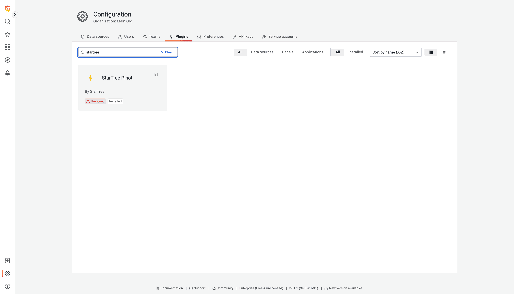
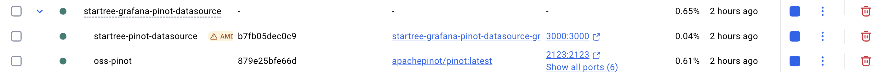
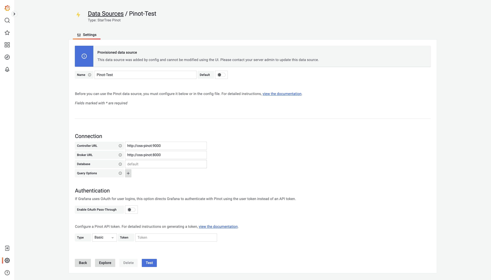

# Pinot Data Source Plugin for Grafana

The Pinot Data Source Plugin for Grafana enables you to visualize and query data from your Apache Pinot cluster directly within Grafana. Build powerful dashboards with time-series visualizations, tables, and more.

## Features

- 🎯 **Visual Query Builder** - Build queries without writing SQL
- 📊 **Multiple Visualization Types** - Support for time-series, tables, and logs
- 🔍 **Advanced Query Editor** - Write custom SQL queries with macro support
- 🔐 **Authentication** - Support for API tokens and OAuth pass-through
- 📈 **Variables & Annotations** - Full support for Grafana variables and annotations
- ⚡ **Performance** - Optimized for large-scale data queries

## Array columns

`STRING_ARRAY` and `FLOAT_ARRAY` columns retain their values as JSON arrays in table results.
Non-finite floats are returned as the strings `"NaN"`, `"Infinity"` and `"-Infinity"`.
Empty arrays and null cells remain distinct. Other array types remain unsupported.

## System Requirements

- **Grafana:** Version 9.1.1 or higher
- **Apache Pinot:** Any version (optimized for latest releases)

## Installation

### From Grafana Marketplace

1. Navigate to **Configuration → Plugins** in your Grafana instance
2. Search for "Pinot" or "StartTree"
3. Click **Install** on the Pinot data source plugin



### Local Installation with Docker

For local development and testing using Docker, refer to the [Testing Guide](TESTING.md).



## Configuration

To configure the Pinot data source in Grafana:

1. Navigate to **Configuration → Data Sources**
2. Click **Add data source**
3. Select **Pinot** from the list
4. Configure the following:
   - **Controller URL** - Your Pinot controller endpoint (e.g., `http://localhost:9000`)
   - **Broker URL** - Your Pinot broker endpoint (e.g., `http://localhost:8000`)
   - **Database** (optional) - Default database name
   - **Authentication** - API token if required
   - **Query Attribution** (optional) - Tag each query with the Grafana user, so you can tell who ran a query when all
     users share one API token (see below)

### Query attribution

When **Query Attribution** is on, every query the plugin sends is tagged with the Grafana user's login and email, and
with the dashboard and panel when the query comes from one. The login is always present and unique; the email is
omitted for users that have none, such as service accounts. The tag is sent twice:

- As Pinot's `clientQueryId` query option. On StarTree, it is stored in the `clientRequestId` column of
  `system_query_log`.
- As a comment at the start of the SQL, because the broker log records the query text but not its options:

  ```sql
  /* clientQueryId: {"source":"grafana","login":"jdoe","email":"jdoe@example.com","dashboardUid":"abc123","panelId":"4"} */
  SELECT ...
  ```

To find who ran the slowest queries:

```sql
SELECT JSON_EXTRACT_SCALAR(clientRequestId, '$.login', 'STRING', '') AS grafanaLogin,
  JSON_EXTRACT_SCALAR(clientRequestId, '$.email', 'STRING', '') AS grafanaEmail, timeUsedMs, query
FROM system_query_log
WHERE clientRequestId LIKE '{"source":"grafana"%'
ORDER BY timeUsedMs DESC
LIMIT 20
```

Queries without a signed-in user (for example, alerting) are tagged with `source` only. A `clientQueryId` set in the
query or data source query options replaces the option, but the comment still names the Grafana user. Attribution is
off by default because it writes user identifiers into Pinot's query log and broker logs. Provisioned data sources set
it with `jsonData.queryAttribution: on` (or `off`).

For detailed configuration instructions, query builders, macros, and advanced features, see the [Plugin Usage & Features Guide](src/README.md).



## Quick Start

1. **Install the plugin** from the Grafana marketplace or locally
2. **Configure a data source** with your Pinot cluster details
3. **Create a dashboard** and add a new panel
4. **Select Pinot as the data source** and choose your query type:
   - Use the **Builder** for visual query construction
   - Use the **Code Editor** for custom SQL queries
5. **Visualize your data** with Grafana's powerful visualization options

## Documentation

### User Guides
- **[Plugin Usage & Features](src/README.md)** - Complete guide on using the plugin, including query builders, macros, and visualization options

### Developer Guides
- **[Development Guide](DEVELOPMENT.md)** - Setup instructions for local development, testing, and contributing
- **[Testing Guide](TESTING.md)** - Step-by-step instructions for testing the plugin locally with OSS Pinot

## Support

- **Issues:** Report bugs and request features on [GitHub Issues](https://github.com/startreedata/startree-grafana-pinot-datasource/issues)
- **Documentation:** [Apache Pinot Documentation](https://docs.pinot.apache.org/)

## Contributing

We welcome contributions! Please see the [Development Guide](DEVELOPMENT.md) for information on setting up your development environment and submitting pull requests.

## License

See [LICENSE](LICENSE) file for details.


